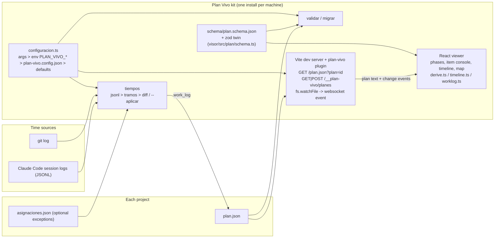

# Plan Vivo

A project plan kept in one JSON file. AI coding agents keep it up to date, and a local live viewer shows phases, real time spent per actor, and a calibrated projection of when the work will finish.

## What problem it solves

When most of a project is built by AI coding agents, it gets hard to answer simple questions: what is done, what is waiting on me, how long each step really took compared to the estimate, and when the work will finish. Plan Vivo answers them from a single `plan.json` that lives in each project:

- **One file, one format.** The plan is split into phases. Each phase holds items: `prompt` (a task given to the agent), `gate` (a human approval) and `unplanned` (something that came up along the way). A JSON Schema and a matching zod schema describe the format.
- **Live viewer.** A localhost React app shows phase cards, a per-phase zoom with an item "console", a timeline and a metro-style map. It reloads by itself whenever `plan.json` is saved. UI in Spanish and English.
- **Real time from real logs.** The `tiempos` command rebuilds each item's `work_log` (time segments per actor: orchestrator, coding agent, subagent, human) from Claude Code session logs and `git log`. It prints a diff by default and writes the plan only with `--aplicar`.
- **Projection.** The viewer derives phase status, progress, pauses and gaps between prompts, then projects the remaining work using a calibration factor (real time / mean estimate of finished items).
- **One install, many projects.** The kit is installed once per machine. Every command takes `--plan <path>`, and a single viewer on one port serves the plans of several projects, each at its own URL.
- **Format versioning.** Each plan carries `schema_version`. `validar` checks a plan against the same schema the viewer uses, and `migrar` upgrades older plans (dry run by default, `.bak` copy when applied).

## Architecture



- **Configuration** (`configuracion.ts`) is shared by every command. Each option can come from a CLI argument, a `PLAN_VIVO_*` environment variable, `plan-vivo.config.json` or a default, in that order, and the error message for a missing path says where the value came from.
- **Schema** exists twice on purpose: `schema/plan.schema.json` for editors and external tools, and a zod schema used by the viewer and `validar`. A test checks both with Ajv on the same fixtures so they cannot drift. Rules JSON Schema cannot express (segment end after start, min not above max, unique item ids) live only in zod.
- **tiempos** (`tiempos/src`) reads session events and subagent runs, opens an item when a human message starts with an identifier such as `F1 · P4:` (configurable regex), assigns time segments per actor, attaches commits, and diffs the proposal against the current plan. `asignaciones.json` handles the exceptions the rule cannot resolve.
- **Server** (`visor/servidor`) is a Vite plugin bound to localhost. It reads plans from disk on every request, watches each file with `fs.watchFile` polling, and pushes a websocket event so the open tab reloads that plan. Adding a plan to a running viewer requires an `X-Plan-Vivo` header (which forces a CORS preflight the server never approves) and an absolute path to an existing `.json`.
- **Viewer** (`visor/src`) is pure derivation: phase status, progress, estimates, timeline lanes, gaps and the calibrated projection are computed from the plan, never stored.

## Screenshots

Captured from the bundled example plan (`ejemplos/plan.json`, a fictional appointment-booking project). The UI is shown in Spanish; an EN toggle switches it to English.

Phase cards with derived status, progress, estimate and real time:


Phase zoom with the item console (estimate vs real, segments per actor, waits, commits):


Timeline with estimate, real segments per actor, gaps between prompts and projection:


Map with a "you are here" marker on the current phase:


## Tech stack

- TypeScript (Node.js 24, `tsx`), pnpm workspace with two packages: `visor` and `tiempos`
- React 19 and Vite 8 (viewer and its dev server plugin)
- zod 4 for runtime validation, JSON Schema 2020-12 with Ajv for the published schema
- Vitest for unit tests, Playwright for end-to-end tests and screenshot generation

## Results

- **159 unit tests passing**: 94 in `visor` (10 files) and 65 in `tiempos` (5 files), from running `pnpm test`.
- **11 end-to-end test cases** defined with Playwright in `visor/e2e/` (counted in the spec files, not run for this README since they need Chrome and fixed local ports).

## Running locally

Requirements: Node.js 24, pnpm 11, git. Google Chrome is needed only for the end-to-end tests.

```bash
git clone https://github.com/wx-quevedo/plan-vivo-kit.git
cd plan-vivo-kit
pnpm install

# Viewer with the bundled example plan, at http://localhost:5190
pnpm visor

# Viewer pointed at your own project's plan (run it again with another plan to add it to the same viewer)
pnpm visor --plan <path-to-your-project>/plan.json

# Validate, rebuild time segments (dry run), migrate format (dry run)
pnpm validar --plan <path-to-your-project>/plan.json
pnpm tiempos --plan <path-to-your-project>/plan.json
pnpm migrar  --plan <path-to-your-project>/plan.json

# Tests and type checks
pnpm test
pnpm typecheck
pnpm e2e
```

From another folder, without moving into the kit:

```bash
pnpm --dir <path-to-plan-vivo> visor -- --plan plan.json
```

To start a new plan, copy `ejemplos/plan-inicial.json` into your project as `plan.json`. `AGENTES.md` holds the full instructions coding agents follow to create and maintain it.

## What I learned / key technical decisions

- **Derive, do not store.** I keep only facts in `plan.json` (item status, estimates, time segments, commits) and compute everything else in the viewer: phase status, progress, pauses, gaps and the projection. That way an agent editing the file can never leave totals out of sync, and the calibration factor improves on its own as items finish.
- **Measure time from logs instead of asking agents to report it.** `tiempos` reconstructs segments from Claude Code session logs and git, keyed on an identifier at the start of each prompt. When I started reading session folders from more than one project, foreign messages carried matching identifiers, so I added `null` in `asignaciones.json` to exclude a message and close the open item. Later the identifier had to be recognized behind blocks the environment prepends to messages, and to allow phase ids with a trailing letter.
- **One install per machine, with versioned data.** I first had a copy of the kit per project, and copies diverged. I moved to a single install where every command takes `--plan`, which meant a format change would hit every project at once, so I added `schema_version` and idempotent migrations with a dry run and a `.bak` backup.
- **One viewer for many plans, still local-only.** Instead of one port per project, a running viewer accepts new plans over a small HTTP endpoint. I protected it with a custom header that forces a CORS preflight the server never approves, plus an absolute-path check, so a page from another origin cannot add files to it.
- **Pragmatic file watching.** On Windows, Vite's watcher dropped the second of two quick saves, so the plugin polls each plan with `fs.watchFile` every 250 ms, which also detects a plan being deleted or created.

## Author

Washington X. Quevedo

- LinkedIn: https://www.linkedin.com/in/wxquevedo
- GitHub: https://github.com/wx-quevedo
