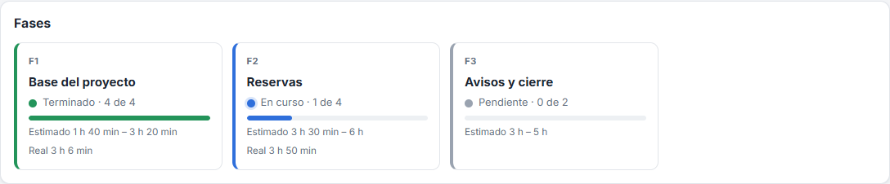
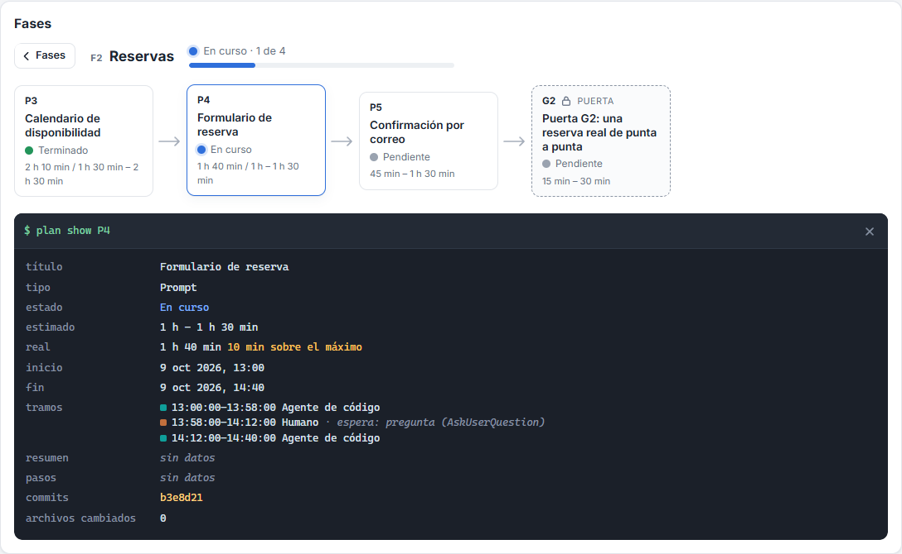
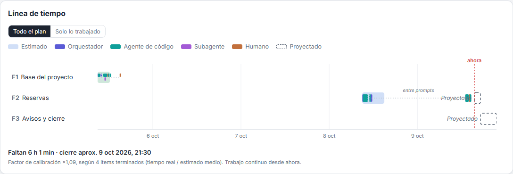

# Plan vivo

Un plan de proyecto en un solo archivo, `plan.json`, que el agente de código mantiene al día y un visor muestra en el navegador.

El plan se divide en fases, y cada fase en items:

- **prompt:** un encargo al agente;
- **puerta (gate):** una aprobación tuya;
- **imprevisto (unplanned):** algo que apareció en el camino.

Cada item guarda su estimado, su estado y los tramos reales de trabajo de cada actor: orquestador, agente de código, subagente y humano. El visor calcula a partir de eso el estado de cada fase, el tiempo real, las pausas y una proyección del cierre. Se recarga solo cada vez que se guarda `plan.json`.

Nació en el proyecto server-monitor y aquí está separado para usarlo en cualquier proyecto.

## Qué se ve

**Fases.** Una tarjeta por fase, con el estado derivado de sus items, el avance, el estimado y el tiempo real.



**Zoom de una fase.** Al tocar una fase aparece la cadena de sus items. Al tocar un item se abre su consola, con:

- el estimado y el tiempo real;
- los tramos por actor;
- las pausas;
- los pasos;
- los commits.



**Línea de tiempo.** Muestra, por fase:

- el estimado (barra tenue);
- los tramos reales por actor;
- las esperas y los huecos entre prompts;
- la proyección de lo que falta, calibrada con lo ya terminado;
- el cierre aproximado.



**Mapa.** Las fases como estaciones, con un «Estás aquí» en la fase en curso.


El visor tiene tema claro y textos en español e inglés (botones ES y EN). No tiene login ni API: lee el archivo local desde la ruta que le indiques.

## Instalación en un proyecto

Requisitos: Node 24, pnpm 11 y git; para `pnpm e2e`, además, Google Chrome. Es lo que se probó; con versiones anteriores no se probó.

1. **Copia el kit dentro del proyecto** como carpeta `plan-vivo/`, o descomprime `plan-vivo-kit.zip` en la raíz del proyecto.
2. **Instala:** `cd plan-vivo` y luego `pnpm install`.
3. **Apunta el kit al plan y avisa al agente:**
   - en `plan-vivo/plan-vivo.config.json` cambia `"plan"` a `"../plan.json"` y ajusta `"zonaHoraria"` si no es la tuya;
   - pega el bloque de `snippet-claude.md` en el `CLAUDE.md` del proyecto.

   El agente crea `plan.json` siguiendo `AGENTES.md`. Si prefieres empezar tú, copia `ejemplos/plan-inicial.json` a la raíz como `plan.json`.
4. **Abre el visor:** `pnpm visor` y entra a http://localhost:5190.

Para ver el ejemplo sin instalar nada en otro proyecto, basta con `pnpm install` y `pnpm visor` en esta carpeta: la configuración que trae apunta a `ejemplos/plan.json`.

## Comandos

Se ejecutan desde la carpeta del kit:

| Comando | Qué hace |
|---|---|
| `pnpm visor` | Levanta el visor en el puerto configurado (5190 por defecto). Acepta `--plan <ruta>`, `--puerto <n>`, `--zona <IANA>` y `--config <ruta>`. |
| `pnpm validar` | Valida `plan.json` con el mismo esquema que el visor y lista los problemas con su ubicación. |
| `pnpm tiempos` | Propone el `work_log` de cada item a partir de las sesiones de Claude Code y de git. Solo muestra diferencias; con `--aplicar` escribe `plan.json`. Ver `AGENTES.md`. |
| `pnpm test` | Pruebas unitarias del visor y del script de tiempos. |
| `pnpm e2e` | Pruebas de punta a punta con Playwright (Chrome instalado). |
| `pnpm capturas` | Regenera las capturas de `docs/capturas/` con el ejemplo. |
| `pnpm typecheck` | Revisa los tipos de TypeScript. |
| `pnpm zip` | Arma `../plan-vivo-kit.zip` con lo que está en git (sin `node_modules`). |

## Configuración

`plan-vivo.config.json`, en la carpeta del kit. Las rutas son relativas a esa carpeta.

| Clave | Por defecto | Para qué |
|---|---|---|
| `plan` | `plan.json` | Ruta de `plan.json`. En un proyecto, `../plan.json`. |
| `puerto` | `5190` | Puerto del visor (solo `localhost`). |
| `zonaHoraria` | `America/Guayaquil` | Zona IANA para mostrar las horas y para escribir los tramos. |
| `repo` | la raíz git de la carpeta de `plan.json` | Repositorio del que el script de tiempos lee los commits. |
| `sesiones` | `~/.claude/projects/<ruta del repo>` | Carpeta de las sesiones de Claude Code. |
| `asignaciones` | `asignaciones.json` junto a `plan.json` | Excepciones del script de tiempos. El archivo es opcional. |
| `identificador` | `\b[A-Z]+\d+\s*·\s*([A-Za-z]+\d+[a-z]?)\s*:` | Expresión que reconoce el item al inicio de un mensaje («F1 · P4:»). |

Cada clave se puede dar también como argumento (`--plan`, `--puerto`, `--zona`, `--repo`, `--sesiones`, `--asignaciones`, `--identificador`) o como variable de entorno (`PLAN_VIVO_PLAN`, `PLAN_VIVO_PUERTO`, etc.). Prioridad: argumento, luego variable, luego archivo.

## Puertos

| Puerto | Uso |
|---|---|
| 5190 | Visor (`pnpm visor`), por defecto. |
| 5191 | Visor de las pruebas e2e, con una copia del ejemplo. |
| 5192 | Visor del kit copiado a una carpeta vacía (prueba e2e de instalación). |

Si 5190 está ocupado, el visor no elige otro: avisa y termina. Usa `--puerto` o la configuración.

## Contenido

```
README.md            este archivo
AGENTES.md           instrucciones para agentes de código: cómo crear y mantener plan.json
snippet-claude.md    bloque para pegar en el CLAUDE.md del proyecto
plan-vivo.config.json
configuracion.ts     lectura de la configuración (visor y tiempos)
schema/              plan.schema.json: JSON Schema del formato, con descripciones
ejemplos/            plan.json (proyecto de ejemplo) y plan-inicial.json (plantilla para empezar)
visor/               el visor (React + Vite), sus pruebas y sus pruebas e2e
tiempos/             el script de tiempos y sus pruebas
docs/capturas/       capturas del visor con el ejemplo
```

Para que el editor valide y complete `plan.json`, agrega al inicio del archivo `"$schema": "plan-vivo/schema/plan.schema.json"`, con la ruta relativa a `plan.json`.
